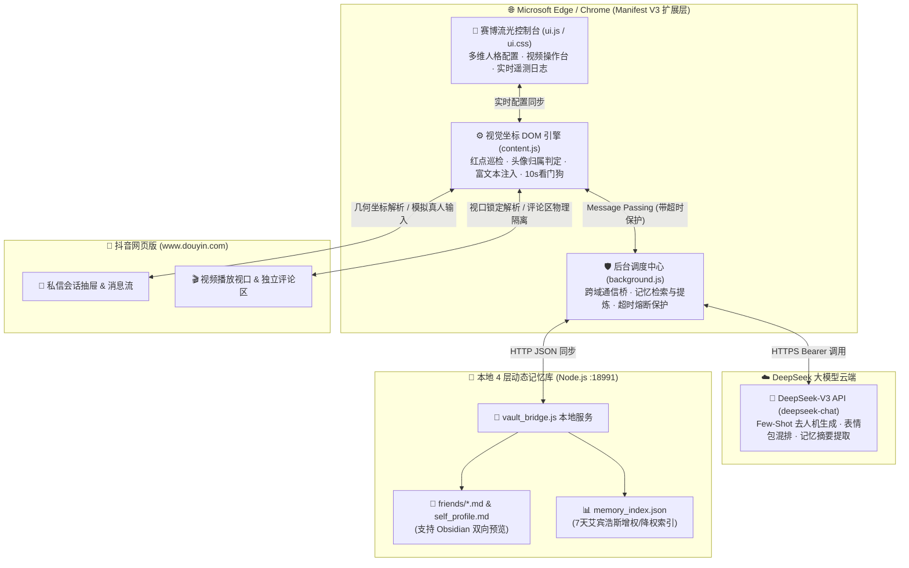

<div align="center">

# 🔥 抖音火花助手 AI (Douyin Spark AI Agent)

**基于 DeepSeek 大模型、浏览器原生 Manifest V3 与 7 天艾宾浩斯动态记忆库的抖音 Web 智能社交 Agent**

[](https://developer.mozilla.org/zh-CN/docs/Web/JavaScript)
[](https://nodejs.org/)
[](https://learn.microsoft.com/en-us/microsoft-edge/extensions-chromium/)
[](#)
[](#)
[](#)

</div>

---

## ✨ 项目简介（Project Overview）

**抖音火花助手 AI (`v1.8.0`)** 是一款专为抖音网页版（`douyin.com`）打造的**纯前端浏览器扩展 + 本地轻量级记忆桥接系统**。它不仅能全天候全自动帮你与好友**秒回消息、每日定时续火花保活**，更颠覆了传统“死板客服式机器人”的痛点：

通过**🎭 多维好友人格分组引擎**、**🧠 7 天艾宾浩斯动态增降权记忆库** 以及 **🎬 AI 多模态看片/神评/转发工作台**，让 AI 真正拥有“死党互怼、偏爱温柔、礼貌得体”的鲜活灵魂与长期共同记忆，甚至能陪你刷抖音、在好友视频评论区精准整活神评、把搞笑视频一键转发给铁哥们吐槽。

---

## 🛠️ 核心开发语言与技术栈（Languages & Tech Stack）

本项目采用模块化、零第三方重型框架依赖的原研架构，代码轻量、执行高效、极易二次开发：

| 维度 | 采用语言 / 技术方案 | 在项目中的核心职责与工程实现 |
| :--- | :--- | :--- |
| **核心编程语言** | **JavaScript (ES6+ / ES2022)** | 全链路异步状态机（`async/await`）、`Promise.race` 超时熔断器、`WeakSet` 内存级防刷屏去重、DOM 几何视觉推理。 |
| **前端界面与交互** | **HTML5 + CSS3 (Glassmorphism)** | 赛博流光毛玻璃悬浮窗（`backdrop-filter`）、抖音霓虹双色呼吸灯、iOS 级丝滑开关动画、实时无感防抖自动保存（`input` 事件流）。 |
| **浏览器扩展架构** | **Chromium Manifest V3 (MV3)** | 遵循最新 Edge / Chrome 扩展安全标准：通过 `Service Worker (background.js)` 隔离跨域请求，利用 `chrome.storage.local` 持久化配置。 |
| **大语言模型引擎** | **DeepSeek-V3 (`deepseek-chat`)** | 接入官方 OpenAI 兼容 RESTful API，采用高多样性采样策略（`temperature: 1.2`, `presence_penalty: 0.9`, `frequency_penalty: 0.9`）结合 Few-Shot 对话注入，彻底根除 AI 机械感与复读机现象。 |
| **抗混淆 DOM 引擎** | **Visual Geometry & Avatar Anchoring** | 针对抖音 Web 端高频动态混淆 CSS Class 的防御机制，摒弃脆弱类名选择器，基于 `getBoundingClientRect()` 视觉坐标锚定与头像方位（左对方/右自己）实现 **100% 零自聊死循环**。 |
| **本地记忆存储服务** | **Node.js + Markdown + JSON** | 基于原生 Node.js (`http` + `fs`) 构建本地 `127.0.0.1:18991` 记忆同步桥，将对话记忆实时沉淀为兼容 **Obsidian** 的 `.md` 档案与 `memory_index.json` 索引。 |
| **认知记忆算法** | **Ebbinghaus 7天动态权重衰减模型** | 模拟人类记忆半衰期（`halfLifeDays: 3.5`）：高频提及的话题自动**增权置顶**，超过 7 天未提及的琐碎日常平滑**降权遗忘**。 |

---

## 🏗️ 系统架构图（System Architecture）



---

## 🚀 六大核心技术亮点（Key Features）

### 1. 🎭 多维好友人格分组引擎（千人千面，彻底去人机）
* 内置 **🌐 默认通用**、**🔥 死党/损友**、**💕 温柔/偏爱**、**🎓 礼貌/长辈** 四大预置人设，支持无限新增自定义分组。
* **死党破限模式**：底层注入真实损友互怼 Few-Shot 语料，支持自然飙口头禅与抖音原生表情码（如 `[狗头]`、`[裂开]`、`[白眼]`、`[泣不成声]`、`[666]`），自动转化为抖音图形表情。
* **智能昵称归一化匹配**：自动剥离抖音会话标题中的火花数字、在线状态、括号人数等杂音，精准匹配好友专属人格。

### 2. 🧠 四层本地动态记忆系统（7 天艾宾浩斯增权/降权）
* **第一层（核心自身人设）**：保存在 `memory_vault/self_profile.md`，定义账号主人的长期性格底色。
* **第二层（好友专属档案）**：自动按好友姓名生成 `memory_vault/friends/好友名.md`，记录双方的共同梗、近况与聊天摘要。
* **第三层（动态权重记忆池）**：通过指数衰减公式 $W(t) = W_0 \cdot 0.5^{\Delta t / 3.5}$ 动态计算记忆热度，7 天内反复聊到的梗权重暴涨，久不提及的旧事自然淡出 Prompt 上下文，既省 Token 又极其拟人。
* **第四层（滑动短期窗口）**：精准截取最近多轮对话气泡（含表情包与图片感知标签），连发刷屏也能一次性打包理解。

### 3. 🎬 AI 多模态看片 · 神评 · 转发工作台
* **👁️ 看懂此片**：基于视口中心锁定算法（`findActiveVideoSlide`），实时提取当前正在播放视频的**作者、文案描述、前 5 条高赞神评**。
* **💬 评当前视频**：严格物理隔离私信输入框与视频评论框（`isInsideVideoCommentArea`），自动在当前视频真实评论区输入并发布贴合人设的犀利神评。
* **📤 一键发给死党**：调用抖音原生分享面板，自动检索死党分组好友并完成视频转发与连带吐槽。

### 4. 🛡️ 视觉坐标级抗混淆 DOM 引擎 & 防死锁看门狗
* **零自聊死循环**：独创 `analyzeMessageOwnership` 逐级向上寻找单头像消息行，结合头像 X 坐标（左对方 / 右自己）双重校验，彻底解决多行文本折行导致的“自己和自己聊天”顽疾。
* **防刷屏漏回**：采用 `WeakSet` 追踪物理 DOM 节点引用，即使好友连续发送相同表情或刷屏，也能逐条或合并秒回。
* **10 秒防死锁看门狗（Watchdog）**：全链路异步通信配备 `sendMessageWithTimeout` 超时熔断与 10 秒看门狗自动复位，永不卡死、永不宕机。

---

## 📦 快速开始（Quick Start）

### 第一步：加载浏览器扩展
1. 打开 **Microsoft Edge**（或 Chrome）浏览器，在地址栏输入：
   ```text
   edge://extensions/
   ```
2. 开启左侧或右上角的 **“开发人员模式 (Developer mode)”**。
3. 点击 **“加载解压缩的扩展 (Load unpacked)”**，选择本项目根目录 `d:\chat`。

### 第二步：（可选）启动本地 Markdown 记忆库桥接服务
若希望把 AI 生成的好友记忆实时写入本地 `d:\chat\memory_vault` 文件夹（可直接用 Obsidian 打开查看）：
```powershell
node d:\chat\memory_vault\vault_bridge.js
```
> 或直接双击运行 `d:\chat\memory_vault\启动记忆桥接服务.bat`（即使不启动，扩展也会自动降级使用浏览器内置 `chrome.storage.local` 维持完整 7 天动态记忆功能）。

### 第三步：在抖音网页版开启智能托管
1. 访问抖音网页版（如 [https://www.douyin.com](https://www.douyin.com) 或私信页）。
2. 点击页面右下角流光呼吸悬浮球 **🔥** 展开控制台。
3. 填入你的 **DeepSeek API Key**（点击 `⚡ 测试连通` 验证），开启 **🤖 启动 AI 全自动秒回与巡检**，并在 **🎭 多维好友人格分组引擎** 中把死党昵称填入对应分组即可！

---

## 📂 项目目录结构（Directory Structure）

```text
d:\chat
├── manifest.json                 # Chromium Manifest V3 扩展描述文件 (v1.8.0)
├── ui.css                        # 赛博流光毛玻璃 UI 样式表 (CSS3 Glassmorphism)
├── ui.js                         # 悬浮控制台交互、多维人格管理与实时配置持久化
├── content.js                    # 核心 DOM 视觉解析引擎、防死锁巡检与视频互动自动化
├── background.js                 # Service Worker：DeepSeek API 调度与 4 层动态记忆引擎
├── icons/                        # 扩展多分辨率图标资源 (16x16 / 48x48 / 128x128)
├── memory_vault/                 # 本地 4 层动态记忆库目录 (Obsidian 兼容)
│   ├── vault_bridge.js           # Node.js 本地文件同步微服务 (127.0.0.1:18991)
│   ├── 启动记忆桥接服务.bat        # Windows 一键启动脚本
│   ├── self_profile.md           # 第一层：账号主人核心人设档案
│   ├── memory_index.json         # 第三层：7天艾宾浩斯动态增降权记忆索引
│   └── friends/                  # 第二层：按好友自动生成的专属记忆 Markdown 档案
└── README.md                     # 项目宣传文档与技术架构说明
```

---

## 🔒 隐私与安全声明（Privacy & Security）

* **API Key 纯本地存储**：您的 DeepSeek API Key 仅保存在本机浏览器的 `chrome.storage.local` 沙箱中，绝不会硬编码在源码或上传至任何第三方服务器。
* **记忆数据完全自主可控**：所有聊天上下文与好友记忆均存储在您本机硬盘（`memory_vault/`），支持随时查阅、编辑或清空。
